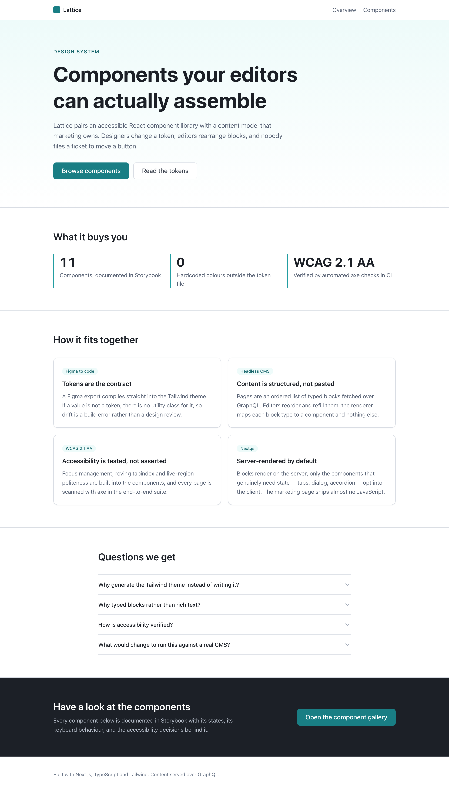
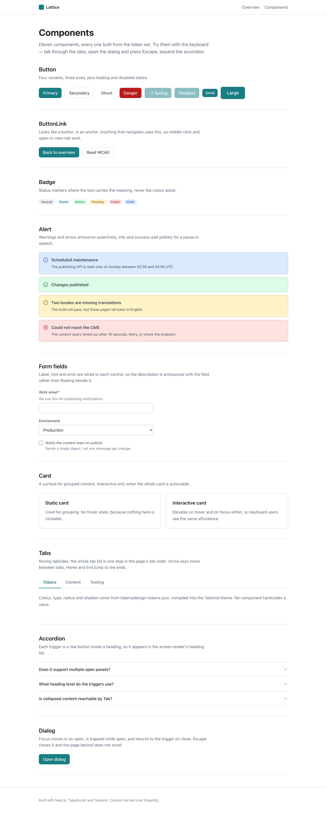
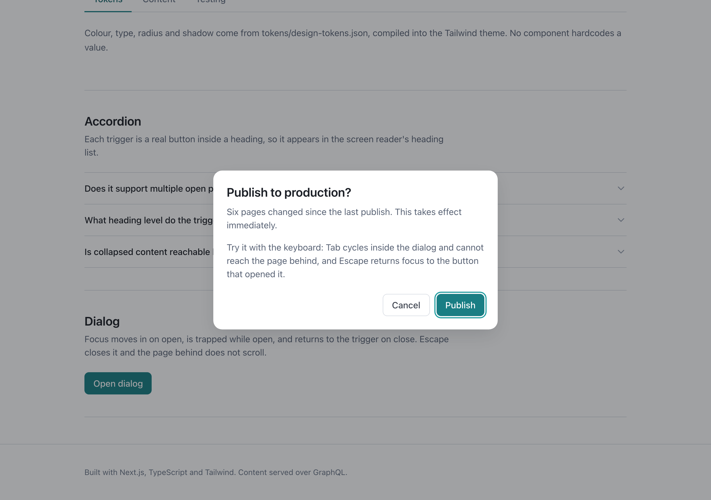

# Lattice

An accessible React component library driven by design tokens, with marketing pages composed from
a headless CMS.

**Next.js** · **TypeScript** · **Tailwind CSS** · **Storybook** · **GraphQL** · **WCAG 2.1 AA** ·
**Vitest + Playwright**



---

## The idea

Three things usually drift apart on a marketing site: what design drew, what the components do, and
what editors can actually publish. Lattice wires them into one path.

```
Figma export          Design tokens         Tailwind theme        Components
(design owns)   ───▶  design-tokens.json ──▶ generated @theme ──▶ no hardcoded values
                                                                        │
CMS content     ───▶  GraphQL (typed blocks) ──────────────────▶ BlockRenderer
(editors own)                                                    exhaustive switch
```

A designer changes a token and re-exports. An editor reorders blocks. Neither files a ticket, and
neither can produce a page the design system doesn't know how to render.

---

## Running it

```bash
npm install
npm run tokens     # compile design tokens into the Tailwind theme
npm run dev        # http://localhost:3000
npm run storybook  # http://localhost:6006
```

No accounts, no API keys. The CMS layer runs in-process against a local GraphQL schema, so a fresh
clone renders the full site immediately. Pointing `CMS_GRAPHQL_ENDPOINT` at Optimizely, Contentful
or Sanity switches to a real backend without touching a component.

---

## Tokens are the contract

`tokens/design-tokens.json` is what a Figma Variables or Token Studio export produces. `npm run
tokens` compiles it into a Tailwind v4 `@theme` block:

```
tokens/design-tokens.json  →  src/app/tokens.css  →  bg-brand-600, text-neutral-500, rounded-lg
```

The point isn't automation for its own sake — it's that **if a value isn't a token, there is no
utility class for it.** A component cannot quietly introduce an off-brand grey, because the class
doesn't exist. Drift becomes a build error instead of something caught in design review three
sprints later.

---

## Content is structured, not pasted

A page is an ordered union of typed blocks, queried with inline fragments the way a headless CMS
expects:

```graphql
blocks {
  __typename
  ... on HeroBlock { eyebrow heading body primaryCta { label href } }
  ... on FaqBlock  { heading questions { id question answer } }
}
```

`BlockRenderer` maps block type to component in an exhaustive switch — the `never` in the default
branch means adding a block to the schema without handling it is a **compile error**, not a blank
space on a live page.

Rich text would have put layout decisions in the editor and unstyleable markup in the database.
Typed blocks keep the editor in charge of *what* and the design system in charge of *how*.

---

## Accessibility, and how it's verified



Eleven components. The interesting ones are where the patterns are genuinely hard:

**Dialog** — focus moves in on open, is trapped while open, and returns to the trigger on close.
Escape closes it; the page behind doesn't scroll. Skipping focus restoration is the common bug: it
dumps a keyboard user at the top of the document with no sense of place.



**Tabs** — roving tabindex, so the whole tab list is **one** stop in the page's tab order rather
than one per tab. Arrow keys move between tabs and wrap; Home and End jump to the ends.

**Button** — a loading button keeps focus and reports `aria-busy`, rather than becoming `disabled`
and silently dropping out of the tab order mid-interaction.

**Form fields** — label, hint and error wired through `htmlFor` and `aria-describedby` in one
shared shell, so no individual control can get it wrong. An error supersedes the hint, so stale
guidance isn't read ahead of the actual problem.

**Alert** — errors and warnings announce assertively; info and success wait politely for a pause in
speech. Getting that backwards is disruptive in a way sighted users never notice.

Verification runs in three layers:

| Layer | Covers |
|---|---|
| **Vitest** — 27 tests | ARIA wiring, keyboard behaviour, focus restoration, scroll locking |
| **Playwright + axe** | Every page scanned at WCAG 2.1 AA, including the dialog while open |
| **Storybook a11y addon** | axe on every story, so regressions surface while building |

### The suite earned its keep immediately

The first axe run failed on two contrast ratios: `neutral-500` at **4.28:1** on white, and
`warning-500` at **4.42:1** on its own surface. Both need 4.5:1 for AA body text, and both were
invisible by eye.

The fix was two values in the token file — `#6f7b8e → #687385` and `#a16207 → #945a06` — and every
use across both pages updated at once. That is the argument for tokens, demonstrated rather than
asserted.

---

## Testing

```bash
npm test          # Vitest — 27 unit tests
npm run e2e       # Playwright — Chromium, Firefox, mobile Safari
```

Keyboard-traversal tests are scoped to desktop projects: the mobile project emulates a touch device
with no physical keyboard, so asserting Tab behaviour there tests something that doesn't exist. The
axe scans and content tests still run everywhere, because contrast and layout very much do apply at
390px.

---

## Layout

```
tokens/design-tokens.json   The contract with design
scripts/build-tokens.ts     Compiles tokens into the Tailwind theme
src/
  components/               11 components, each with stories and tests alongside
  blocks/BlockRenderer      The only place content meets presentation
  cms/
    content.ts              Content store — swap for a real CMS
    schema.ts               GraphQL schema, blocks as a union
    client.ts               The page query; in-process or over HTTP
  app/                      Next.js App Router — server components by default
e2e/
  accessibility.spec.ts     axe against every page
  keyboard.spec.ts          What axe cannot see
  content.spec.ts           CMS rendering and the API
```

## Decisions worth knowing

**Server components by default.** The marketing page ships **991 B** of JavaScript. Only the
components that genuinely need state — tabs, dialog, accordion — opt into the client.

**`ButtonLink` is separate from `Button`.** Anything that navigates must be an `<a>`: middle-click,
open-in-new-tab, and the browser's link list all depend on it. A `<button onClick={router.push}>`
looks identical and breaks all three.

**No `clsx` or `tailwind-merge`.** Variants are looked up from a record rather than concatenated
conditionally, so conflicting utilities never get generated. A merge library would paper over that
design.

## Scripts

| Command | Does |
|---|---|
| `npm run dev` | Dev server |
| `npm run tokens` | Recompile the Tailwind theme from tokens |
| `npm run storybook` | Component docs with the a11y addon |
| `npm test` | Vitest |
| `npm run e2e` | Playwright across three projects |
| `npm run typecheck` | Strict, with `noUncheckedIndexedAccess` |
| `npm run build` | Production build |
